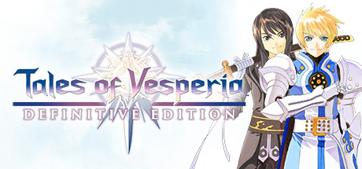

**Tales of Vesperia is a beloved entry in the Tales series following Yuri Lowell, a former Imperial Knight turned outlaw hero, on a quest to protect the world's Blastia energy sources. Features fast combo-based combat and one of the series' most beloved casts.**

---

## 📖 About

Tales of Vesperia is a beloved entry in the Tales series following Yuri Lowell, a former Imperial Knight turned outlaw hero, on a quest to protect the world's Blastia energy sources. Features fast combo-based combat and one of the series' most beloved casts.

## ⚠️ Problems Without Trainer

| Problem | Status |
|---------|--------|
| **Arte Grind** — Mastering artes requires using them thousands of times to learn | ✅ Solved |
| **Miss-able Content** — Many substories and costumes locked behind specific in-game flags | ✅ Solved |
| **Difficulty Scaling** — Final dungeon difficulty spikes sharply over mid-game | ✅ Solved |
| **Synthesis Complexity** — Item synthesis system requires extensive crafting knowledge | ✅ Solved |

## ✅ Solution

The **Tales of Vesperia Trainer** solves all these issues by giving you complete control over the game.

## 🎯 Full Feature List

- Unlimited Resources
- God Mode / Invincibility
- Instant Skill Cooldown
- One-Hit Kill
- Freeze Game Timer
- Unlock All Items & Achievements
- Custom Speed Multiplier
- Save State Anywhere

## 🚀 Quick Start

1. **Disable Windows Defender** temporarily (trainer may trigger false positive)
2. Download the trainer from the button above
3. Launch Tales of Vesperia
4. Run the trainer as Administrator
5. Activate desired cheats with hotkeys

## 💎 Free vs Paid

| Feature | Free | Pro |
|---------|------|-----|
| Basic God Mode | ✅ | ✅ |
| Unlimited Resources | ✅ | ✅ |
| All Advanced Cheats | ❌ | ✅ |
| Auto-Updates | ❌ | ✅ |
| Priority Support | ❌ | ✅ |

## 💻 Requirements

- Windows 10/11 (64-bit)
- Tales of Vesperia (any version)
- .NET Framework 4.8+
- DirectX 11+

## 🍎 macOS

macOS users can use our alternative tool:

## ⚖️ Legal

This trainer is for educational and single-player use only. Use responsibly.

---

